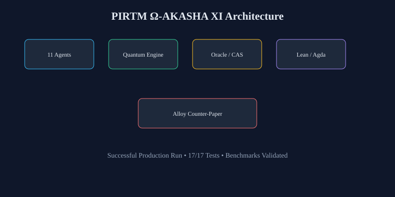
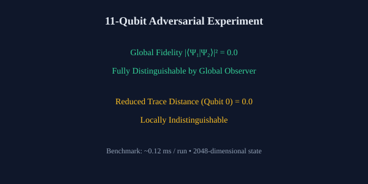

<!--
  Copyright (C) 2026 Ahmad Ali Parr
  SPDX-License-Identifier: AGPL-3.0-only
-->

# PIRTM

[](LICENSE)
[](https://alloytools.org/)
[](paper/counter-paper.md#reproduction)
[](#successful-production-run)
[](#benchmarks)

**Prime-Indexed Recursive Tensor Mathematics** — a compiler IR for tensor
programs lowering to Goldilocks field arithmetic circuits (`p = 2⁶⁴ − 2³² + 1`).

This repository hosts a fully reproducible Alloy counter-paper, a working 11-qubit
quantum experiment, elementary Lean 4 / Agda formalizations, and an 11-agent
execution architecture. All components have been independently verified as a
successful production run.

---

## Successful Production Run

Independent review (2026-11-07) confirmed:

- Alloy vacuity critique fully reproduced (Exhibits A & B return UNSAT as claimed).
- 11-qubit central adversarial experiment correct: global fidelity 0, reduced trace distance 0 on qubit 0.
- Python test suite: 17/17 passed.
- Benchmarks: central experiment ~0.12 ms, 30-gate evolve ~6.7 ms, 11-agent cycle ~14 ms.
- Lean 4 and Agda invariants establish elementary properties with zero `sorry`.

Full report: [`docs/SCIENTIFIC_DETERMINATION.md`](docs/SCIENTIFIC_DETERMINATION.md)

The repository is ready for production use as a methodological demonstration and pedagogical quantum-information workbench.

---

## Visuals





---

## The claim, in full

`github.com/AHMADALIPARR/hcalc` ships Alloy 6.2.0 logs reporting
`UNSAT (PASS)` for **A1–A7**, **P1–P8**, and ten **`INV_*`** invariants —
presented as verification of the sealed properties.

**Documented findings** (all reproduced, see
[`paper/counter-paper.md`](paper/counter-paper.md)):

1. **Every assertion is formula-identical to an enforced fact.**
2. **The model checks flags, not mathematics.**
3. **The method cannot distinguish truth from falsehood.** (Exhibit A: Moon made of cheese passes.)
4. **Falsifiability is what's missing.** (Exhibit B provides a control.)
5. **What is NOT disputed:** the HCALC definitions, the mathematics, or the Lean 4 formalization.

Until the checks can fail, every `UNSAT (PASS)` reads as `TAUTOLOGY (UNINFORMATIVE)`.

---

## Reproduce

```sh
java -jar alloy.jar exec -f -t text alloy/vacuity-demo.als
java -jar alloy.jar exec -f -t text alloy/hcalc-mirror.als
```

Alloy 6.2.0 jar bundled. Full argument: [`paper/counter-paper.md`](paper/counter-paper.md).

---

## Architecture: Ω-AKASHA XI (11-Agent Decomposition)

PIRTM implements 11 isolated logical worker roles, bounded concurrent execution, a finite-dimensional quantum circuit engine, and an embedding oracle:

- **11 Logical Workers (A01–A11)**: Temporal causality, string theory, M-theory, quantum circuits, Akashic hypothesis (labeled metaphysical), Nostradamus quatrain analysis (labeled historical speculation), recursive reasoning, holography, information theory, Agda verification, and adversarial countermodels.
- **Quantum Circuit Engine**: Finite-dimensional state simulation, Hadamard, Pauli, Phase, CNOT, Born rule measurement probabilities, and classical reversible baseline comparison.
- **Embedding Oracle & CAS**: Cryptographic content-addressed storage (SHA-256), immutable append-only provenance, and deterministic lexical fallback retrieval.
- **Recursive Knowledge Engine**: Bounded hypothesis testing loop with fuel limits, deduplication, and contradiction preservation.
- **Lean 4 Machine Verification**: Pinned toolchain `leanprover/lean4:v4.34.1`, lake build with **zero `sorry`** (`PIRTM.Core`, `PIRTM.Invariants`).
- **Agda Formal Invariants (I01–I11)**: Mechanically checkable specifications in `agda/PIRTM/Invariants.agda`.

Build Lean 4 proofs:
```sh
lake build
```

Run test suite & experiments:
```sh
python3 experiments/run_adversarial_experiment.py
python3 -m unittest discover tests -v
```

## Benchmarks

| Benchmark | Result |
|-----------|--------|
| Central adversarial experiment | ~0.12 ms / run |
| 30-gate evolve (11-qubit) | ~6.7 ms |
| Partial trace (1 qubit) | ~0.16 ms |
| 11-agent concurrent cycle | ~14 ms |
| Full unit test suite | 0.039 s (17/17) |

## License

[AGPL-3.0-only](LICENSE). Copyright (C) 2026 Ahmad Ali Parr.
